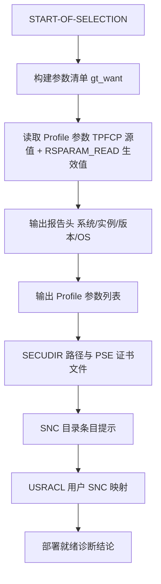
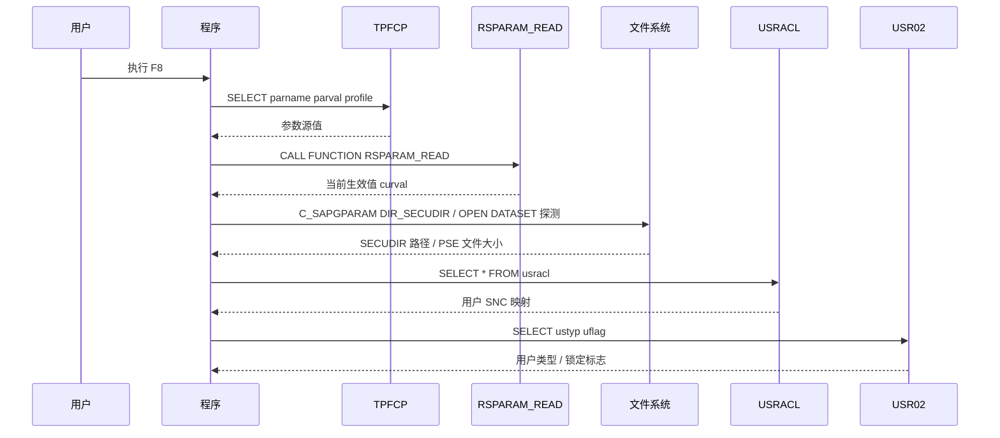

# ZSNC_SSO_INFO 程序分析报告

## 一、程序定位与业务背景

**解决什么问题**：在 SNC（Secure Network Communications）/ Kerberos 透明 SSO 部署与排障场景下，管理员需要一次性拿到三类关键事实——SNC 相关 profile 参数的**源值（TPFCP）与当前生效值（RSPARAM_READ）**、`SECUDIR` 证书库路径与 PSE 证书文件的存在性、以及**用户到 SNC 名称的映射（USRACL）**，并据此得到"部署是否就绪"的结论。

**为什么现有手段不够**：逐项核对通常要靠 RZ11（参数）、SM30/SM59（SNC 目录）、文件系统（SECUDIR 下的 PSE）三个入口分开查，还要手工比对"profile 源值 vs 实际生效值"这一对容易不一致的数据。本报表把这些入口收敛成一个只读界面，并直接给出 OK / FAIL / WARN 结论，缩短部署排障回路。

**整体设计范式一句话定性**：一个自包含、无 OO、无写操作的单事件块报表（`START-OF-SELECTION` 独占全部逻辑），以"选择屏开关控制采集范围 → 采集 → 格式化输出 → 汇总诊断"的线性流水线组织，属于经典的 SE38 诊断工具风格。

**数据来源**：TPFCP（参数源值）、USRACL（用户 SNC 映射）、USR02（用户类型/锁定标志）三张标准表 + `RSPARAM_READ`（当前生效值）+ `C_SAPGPARAM`（SECUDIR 系统路径）。只读，无 `INSERT/UPDATE/DELETE`。

---

## 二、程序执行流程总览



| 步骤 | 子程序 | 调用者 | 职责 |
|---|---|---|---|
| 1 | 事件块 `START-OF-SELECTION` | 报表 F8 入口 | 构建关注参数清单（固定核心清单 + 用户过滤 + p_all 全量开关） |
| 2 | 事件块 `START-OF-SELECTION` | 步骤 1 | 逐参数读 TPFCP 源值与 RSPARAM_READ 当前值 |
| 3 | 事件块 `START-OF-SELECTION` | 步骤 2 | 输出系统信息报告头 |
| 4 | 事件块 `START-OF-SELECTION` | 步骤 3 | 输出 Profile 参数表（布尔着色） |
| 5 | 事件块 `START-OF-SELECTION` | 步骤 4 | 取 SECUDIR 路径，枚举 11 个候选 PSE 文件的存在性与大小 |
| 6 | 事件块 `START-OF-SELECTION` | 步骤 5 | 输出 SNC 目录人工核对提示 |
| 7 | 事件块 `START-OF-SELECTION` | 步骤 6 | 输出 USRACL 用户映射（逐行回查 USR02） |
| 8 | 事件块 `START-OF-SELECTION` | 步骤 7 | 汇总 OK/FAIL/WARN 诊断结论 |

下面按这条流程，逐个子程序（步骤）展开。

---

## 三、分组分析

### 3.1 事件块 `START-OF-SELECTION` — 构建关注参数清单

#### ① 固定核心清单 + 用户过滤

```abap
* 关注的 SNC/profile 参数（固定核心清单）
  APPEND 'snc/enable'               TO gt_want.
  APPEND 'snc/identity/as'          TO gt_want.
  APPEND 'snc/identity/per'         TO gt_want.
  APPEND 'snc/gss_lib'              TO gt_want.
  APPEND 'snc/accept_insecure_gss'  TO gt_want.
  APPEND 'snc/accept_insecure_ssl'  TO gt_want.
  APPEND 'snc/accept_insecure_cpic' TO gt_want.
  APPEND 'snc/accept_insecure_rfc'  TO gt_want.
  APPEND 'snc/data_protection/use'  TO gt_want.
  APPEND 'snc/data_protection/max'  TO gt_want.
  APPEND 'snc/data_protection/min'  TO gt_want.
  APPEND 'snc/extid_login_diag'     TO gt_want.
  APPEND 'snc/extid_use_udd'        TO gt_want.
  APPEND 'secudir'                  TO gt_want.
  APPEND 'DIR_SECUDIR'              TO gt_want.

  IF p_parm IS NOT INITIAL.
    APPEND p_parm TO gt_want.
  ENDIF.
  SORT gt_want.
  DELETE ADJACENT DUPLICATES FROM gt_want.
```

**做什么** —

1. 向 `gt_want` 逐条追加 15 个固定核心参数名（`snc/enable`、`snc/identity/as`、`snc/identity/per`、`snc/gss_lib`、5 个 `snc/accept_insecure_*`、3 个 `snc/data_protection/*`、`snc/extid_login_diag`、`snc/extid_use_udd`、`secudir`、`DIR_SECUDIR`）。
2. 选择屏上 `p_parm` 非空时，把用户输入的自定义参数名也追加进 `gt_want`。
3. 对 `gt_want` 排序并去除相邻重复项，保证后续读取与展示稳定有序。

**为什么** — 采用"固定核心清单 + 单参数过滤"而非无条件全表扫描，是为了让默认运行就能覆盖 SNC 排障最常用的参数面，同时避免把 TPFCP 里几十上百个无关参数一起拖出来。`SORT + DELETE ADJACENT DUPLICATES` 是 ABAP 对标准表去重的标准姿势，保证 `p_parm` 与固定清单重叠时只出现一次。

**风险与改进** — 两个点：① 固定清单是硬编码的，`snc/*` 参数随版本会新增（例如 `snc/extid_login_diag` 这类较新的项），清单滞后于系统实际支持的参数集；建议 `p_all` 之外再提供"动态发现"开关，直接从 `TPFCP WHERE parname LIKE 'snc/%'` 拉取。② 清单里同时含 `secudir` 与 `DIR_SECUDIR` 两个名，语义上指向同一目录，展示时会重复；二者在 TPFCP 中一个可能是参数、一个可能是内部名，建议只在诊断结论里用其一，避免同屏两行歧义。

#### ② p_all 全量开关

```abap
* p_all=on：改为列出系统上所有 snc* 参数
  IF p_all IS NOT INITIAL.
    CLEAR gt_want.
    IF p_parm IS NOT INITIAL.
      APPEND p_parm TO gt_want.
    ELSE.
      SELECT DISTINCT parname FROM tpfcp INTO TABLE gt_want
        WHERE parname LIKE 'snc/%'
           OR parname LIKE 'ssl/%'.
      SORT gt_want.
    ENDIF.
  ENDIF.
```

**做什么** —

1. 勾选 `p_all` 时清空 `gt_want`，丢弃固定核心清单。
2. `p_parm` 非空则仅保留该自定义参数；为空则从 `TPFCP` 取出全部 `snc/%` 与 `ssl/%` 参数名（去重）装入 `gt_want`，再排序。

**为什么** — `p_all` 提供"从固定清单切到全量清单"的逃生舱：当标准清单覆盖不到某个新参数或 ssl 相关参数时，管理员勾上即可看到系统实际定义的全部相关参数。`LIKE 'snc/%' OR LIKE 'ssl/%'` 用 `DISTINCT` 保证结果集无重复。

**风险与改进** — 查询条件是 `snc/%` 与 `ssl/%` 两个前缀，但 SNC 相关参数并不只有这两个前缀（如 `snc/extid_*` 已含在内，但部分发行版还有 `snc/data_protection` 之外的命名）；`WHERE parname LIKE 'snc/%'` 依赖 TPFCP 上 `parname` 的索引可用性，若该表在目标系统无合适索引会退化为全表扫描。建议把 `ssl/%` 换成 `secudir` 之外的更精确前缀集，或干脆列出 `parname LIKE '%snc%'`。

### 3.2 事件块 `START-OF-SELECTION` — 读取 Profile 参数（TPFCP 源值 + 当前生效值）

```abap
  LOOP AT gt_want ASSIGNING <fs_w>.
    SELECT SINGLE parname parval profile
      FROM tpfcp
      INTO gs_parm
      WHERE parname = <fs_w>.
    IF sy-subrc = 0.
      CALL FUNCTION 'RSPARAM_READ'
        EXPORTING
          pname = gs_parm-parname
        IMPORTING
          pval  = gs_parm-curval.
      APPEND gs_parm TO gt_parm.
    ELSE.
*     参数未在 TPFCP 中显式定义：仍尝试读取当前生效值
      CLEAR gs_parm.
      gs_parm-parname = <fs_w>.
      CALL FUNCTION 'RSPARAM_READ'
        EXPORTING
          pname = gs_parm-parname
        IMPORTING
          pval  = gs_parm-curval.
      IF gs_parm-curval IS NOT INITIAL.
        APPEND gs_parm TO gt_parm.
      ENDIF.
    ENDIF.
  ENDLOOP.
```

**做什么** —

1. 遍历 `gt_want`，每个参数以 `parname = <fs_w>` 为键从 `TPFCP` 取 `parname/parval/profile` 三列进 `gs_parm`。
2. 命中（`sy-subrc = 0`）时，调用 `RSPARAM_READ` 以 `pname = gs_parm-parname` 取当前生效值写入 `gs_parm-curval`，随后把 `gs_parm` 追加进 `gt_parm`。
3. 未命中（参数未在 TPFCP 显式定义）时，清空 `gs_parm`、只填 `parname`，仍调用 `RSPARAM_READ` 取生效值；`curval` 非空才追加进 `gt_parm`。

**为什么** — 这是本报表的核心设计：TPFCP 记的是 profile 文件的**源值**，而 `RSPARAM_READ` 返回的是实例**当前实际生效值**，二者在参数被实例级覆盖/动态调整时不一致。同时读出并展示这对值，正是排障时最需要确认的"配置是否真的生效"。未命中分支说明参数可能只存在于运行配置而未写进 profile 文件，此时仍尝试读生效值，避免漏报。

**风险与改进** — 三处：① `RSPARAM_READ` 未检查 `sy-subrc` 也未见 `EXCEPTIONS` 参数，若参数名非法或调用失败，`curval` 保持初始值，该行会被当作"参数无值"展示，无法区分"真无值"与"读取失败"；建议校验 `sy-subrc` 并打 WARN 标记。② `SELECT SINGLE` 每次单条、`LOOP AT` 逐参数执行，参数多时是 N 次单条查询 + N 次 FM 调用，对诊断工具可接受，但可改用 `SELECT ... FOR ALL ENTRIES IN gt_want` 一次性取回 TPFCP 源值再循环。③ 未命中分支里 `curval IS NOT INITIAL` 作为是否追加的判据，会把"参数生效值为 0/空串但确有值"的情形漏掉；`0` 会通过判空检查（非 initial），但真正为空串的参数不会展示，属于口径选择，需在 SE38 核实 `RSPARAM_READ` 对空值参数的返回行为。

### 3.3 事件块 `START-OF-SELECTION` — 报告头

```abap
  WRITE: / '=' CENTERED 100,
         / 'SAP SNC / Kerberos SSO - 部署信息报告' CENTERED 100,
         / '=' CENTERED 100,
         /(20) '系统'      , sy-sysid,
         /(20) '实例'      , sy-mandt,
         /(20) '版本'      , sy-releas,
         /(20) 'OS'        , sy-opsys,
         /(20) '主机/应用' , sy-host,
         /(20) '日期'      , sy-datum,
         /(20) '时间'      , sy-uzeit,
         / '=' CENTERED 100,
         /.
```

**做什么** —

1. 用 `WRITE ... CENTERED 100` 输出标题分隔线、报告标题、再一条分隔线。
2. 以 `(20)` 左对齐标签 + 值的形式输出 7 个系统字段：`sy-sysid`、`sy-mandt`、`sy-releas`、`sy-opsys`、`sy-host`、`sy-datum`、`sy-uzeit`。
3. 末尾再补一条分隔线与空行。

**为什么** — 报告头把"这是哪套系统、什么版本、什么 OS、什么时间生成的报告"固定下来，让诊断结果可以被归档、跨系统比对；`sy-opsys` 尤其重要，因为后续 SECUDIR 路径拼接依赖 OS（见 3.5 的风险项）。

**风险与改进** — 无明显风险。标题用 `CENTERED 100` 而正文各节用 150/115 列宽（见 3.4/3.7），分隔线宽度与正文列宽不一致，会在报表输出时出现标题 100 列、正文超出 100 列的对不齐现象，属于排版口径不统一。

### 3.4 事件块 `START-OF-SELECTION` — Profile 参数输出

```abap
  WRITE: / '--- 1. Profile 参数 (TPFCP / 当前生效值) ---'.
  ULINE.
  WRITE: /(50) '参数名', (50) '值', /(50) '来源 Profile'.
  ULINE.
  LOOP AT gt_parm INTO gs_parm.
    IF gs_parm-parval = '1' OR gs_parm-parval = 'true' OR
       gs_parm-parval = 'TRUE'.
      FORMAT COLOR COL_POSITIVE.
    ELSEIF gs_parm-parval = '0' OR gs_parm-parval = 'false' OR
           gs_parm-parval = 'FALSE'.
      FORMAT COLOR COL_NEGATIVE.
    ENDIF.
    WRITE: /(50) gs_parm-parname, (50) gs_parm-parval, (50) gs_parm-profile.
    FORMAT COLOR OFF.
  ENDLOOP.
  FORMAT RESET.
```

**做什么** —

1. 输出节标题 `--- 1. Profile 参数 (TPFCP / 当前生效值) ---` 并画表头线。
2. 遍历 `gt_parm`，按 `gs_parm-parval` 是否为 `1/true/TRUE`（绿）或 `0/false/FALSE`（红）切换 `FORMAT COLOR`，否则默认色。
3. 每行输出 `parname`、`parval`、`profile` 三列各占 50，随后 `COLOR OFF`，循环结束 `FORMAT RESET`。

**为什么** — 布尔型 SNC 参数（`snc/enable`、`snc/accept_insecure_*` 等）用绿/红着色，让管理员一眼扫出"哪些该开的开了、哪些该关的还开着"；`true/TRUE` 大小写并容，兼容不同 profile 文件里的写法差异。

**风险与改进** — 两处：① 着色只判断 `parval`（TPFCP 源值），不判断 `curval`（当前生效值）——若实例级覆盖使二者不同，颜色反映的仍是源值而非实际生效值，与"看生效值"的排障目标错位；建议对 `parval <> curval` 的行单独标记（如 `[覆盖]`）并以其为准着色。② 列宽 `(50)+(50)+(50)=150` 超出报告头 `CENTERED 100` 的 100 列，`WRITE` 会把超宽行折行，导致参数名/值/来源三列在窄终端上错位；建议按 100 列重新分配（如 40/30/30）或改 ALV 输出。

### 3.5 事件块 `START-OF-SELECTION` — SECUDIR 路径与 PSE 证书文件

#### ① SECUDIR 路径

```abap
  CALL 'C_SAPGPARAM' ID 'DIR_SECUDIR' FIELD lv_secu.
  WRITE: /, / '--- 2. SECUDIR 与证书 PSE ---'.
  ULINE.
  IF lv_secu IS INITIAL.
    SELECT SINGLE parval FROM tpfcp INTO lv_secu WHERE parname = 'secudir'.
  ENDIF.
  WRITE: /(50) 'SECUDIR 路径', (50) lv_secu.
  IF lv_secu IS INITIAL.
    WRITE: / '  [WARN] SECUDIR 未配置！' COLOR COL_NEGATIVE.
  ENDIF.
```

**做什么** —

1. 用 `CALL 'C_SAPGPARAM'` 以 `ID 'DIR_SECUDIR'` 取出系统实际 SECUDIR 路径到 `lv_secu`。
2. `lv_secu` 为空时，回退从 `TPFCP` 取 `parname = 'secudir'` 的 `parval` 作为兜底。
3. 输出 `SECUDIR 路径` 一行；仍为空则输出 `[WARN] SECUDIR 未配置！` 红字。

**为什么** — `C_SAPGPARAM` 是拿系统运行时目录的最权威途径，能反映实例实际使用的 SECUDIR；`TPFCP` 兜底用于 `C_SAPGPARAM` 未返回时的退化场景，保证在部分环境仍能给出线索。

**风险与改进** — 兜底分支读的是 `TPFCP.parval`（profile 源值），与 `C_SAPGPARAM` 的"实际生效值"口径不一致；若二者不同（例如 profile 改了但实例未重启），兜底会给出过期路径。建议兜底改为 `RSPARAM_READ` 读 `secudir` 的当前值，与 3.2 的取值口径统一。

#### ② PSE 候选文件枚举与检测

```abap
  IF p_pse IS NOT INITIAL AND lv_secu IS NOT INITIAL.
    DATA(lt_cand) = VALUE string_table(
      ( 'SAPSNCS.pse' ) ( 'SAPSSLS.pse' ) ( 'SAPSSLC.pse' )
      ( 'SAPSSLO.pse' ) ( 'SAPNCSS.pse' ) ( 'SAPNCSP.pse' )
      ( 'SAPSNCS.crt' ) ( 'SAPSNCS.cer' ) ( 'SAPSNCS.key' )
      ( 'SAPSNCS.cred.v2' ) ( 'SAPSNCS.cred' ) ).
    LOOP AT lt_cand INTO DATA(lv_cand).
      CLEAR lv_file. lv_file = lv_secu && '\' && lv_cand.
      lv_len = 0. lv_ok = ''.
      OPEN DATASET lv_file FOR INPUT IN BINARY MODE.
      IF sy-subrc = 0.
        READ DATASET lv_file INTO DATA(lv_dummy) LENGTH lv_len.
        CLOSE DATASET lv_file.
        lv_ok = 'X'.
      ENDIF.
      gs_pse-name = lv_cand.
      gs_pse-ok   = lv_ok.
      gs_pse-stat = COND string( WHEN lv_ok IS NOT INITIAL THEN '存在'
                                 ELSE '缺失' ).
      IF lv_ok IS NOT INITIAL.
        gs_pse-len = |{ lv_len } bytes|.
      ELSE.
        CLEAR gs_pse-len.
      ENDIF.
      APPEND gs_pse TO gt_pse.
    ENDLOOP.
    WRITE: /(50) '文件', (50) '状态', (50) '大小'.
    ULINE.
    LOOP AT gt_pse INTO gs_pse.
      IF gs_pse-ok IS NOT INITIAL.
        FORMAT COLOR COL_POSITIVE.
      ELSE.
        FORMAT COLOR COL_NEGATIVE.
      ENDIF.
      WRITE: /(50) gs_pse-name, (50) gs_pse-stat, (50) gs_pse-len.
      FORMAT COLOR OFF.
    ENDLOOP.
    FORMAT RESET.
  ENDIF.
```

**做什么** —

1. `p_pse` 勾选且 `lv_secu` 非空时，构造 11 个候选文件名（`SAPSNCS.pse`、`SAPSSLS.pse`、`SAPSSLC.pse`、`SAPSSLO.pse`、`SAPNCSS.pse`、`SAPNCSP.pse`、`SAPSNCS.crt`、`SAPSNCS.cer`、`SAPSNCS.key`、`SAPSNCS.cred.v2`、`SAPSNCS.cred`）到 `lt_cand`。
2. 遍历候选，用 `lv_secu` 拼 `\` 加文件名构成完整路径 `lv_file`，`OPEN DATASET ... FOR INPUT IN BINARY MODE` 探测。
3. 打开成功（`sy-subrc = 0`）时 `READ DATASET ... LENGTH lv_len` 读入大小、`CLOSE DATASET`、置 `lv_ok = 'X'`。
4. 组装 `gs_pse`（`name/ok/stat/len`），`stat` 由 `COND` 判 `存在`/`缺失`，`len` 存在时格式化为 `<字节数> bytes`，追加进 `gt_pse`。
5. 输出 `文件/状态/大小` 表头与表体，存在者绿、缺失者红。

**为什么** — 把 SNC/Kerberos 相关的常见 PSE 与证书文件（`.pse/.crt/.cer/.key/.cred*`）一次性枚举，比让管理员逐个 `ls` 更快；`BINARY MODE` 打开 + 读长度给出文件大小，用于判断"文件在不在 + 是否为空/异常小"。`COND` 内联是较新的 ABAP 写法，保持代码紧凑。

**风险与改进** — 这是全报告问题最集中的一段：

- **路径分隔符硬编码 `\`**：`lv_secu && '\' && lv_cand` 写死 Windows 反斜杠。而报告头已输出 `sy-opsys`，目标系统完全可能是 Linux/Unix 应用服务器，此时拼出的路径形如 `/usr/sap/SNC\SAPSNCS.pse`，`OPEN DATASET` 必然失败，**所有 PSE 会被误报"缺失"**，诊断结论随之误判。应按 `sy-opsys` 选分隔符（如 `COND #( WHEN sy-opsys CS 'WIN' THEN '\' ELSE '/' )`）。
- **`READ DATASET ... LENGTH lv_len` 传入 0**：`READ DATASET` 的 `LENGTH` 是"输入=本次最多读取字节数、输出=实际读取字节数"的双向参数；此处第 3 步先 `lv_len = 0` 再传入，等于要求读取 0 字节，`lv_len` 回读后仍为 0，**"大小"列恒显示 `0 bytes`**，大小信息形同虚设。正确做法是用 `FILE_GET_SIZE`（应用服务器端 FM）取文件长度，或改用 `OPEN DATASET` + 循环分块读统计字节数。
- **整文件读入内存只为取长度**：即便 `LENGTH` 参数正确，`READ DATASET ... INTO DATA(lv_dummy)` 会把整个 PSE 读进一个无名工作区，只为得到一个字节数；PSE 通常只有几 KB 尚可，但若 SECUDIR 下出现大文件，这是纯浪费，且 `DATA(lv_dummy)` 未显式定长，其实际读取行为需在 SE38 核实（内联声明在 `READ DATASET` 中是否被推断为定长 C 类型）。

### 3.6 事件块 `START-OF-SELECTION` — SNC 目录条目提示

```abap
  IF p_snc IS NOT INITIAL.
    WRITE: /, / '--- 3. SNC 目录条目 (请人工核对) ---'.
    ULINE.
    WRITE: / '  服务端 SNC 目录（服务 <-> SNC 名称）请用 SM30/SM59 核对；'
            '用户映射见下一节 USRACL。' COLOR COL_HEADING.
  ENDIF.
```

**做什么** —

1. `p_snc` 勾选时输出节标题 `--- 3. SNC 目录条目 (请人工核对) ---`。
2. 输出一行提示：服务端 SNC 目录（服务与 SNC 名称的对应）请用 `SM30/SM59` 人工核对，用户映射见下一节 `USRACL`。

**为什么** — SNC 目录的"服务 <-> SNC 名称"映射没有一张可直接 `SELECT` 的权威表，强行读会得到不可靠数据；因此设计上明确放弃自动采集，改成输出人工核对指引，把这条信息的正确性责任交还给管理员。这是诚实的设计取舍。

**风险与改进** — 该节只是提示，无采集逻辑，风险低。但 `WRITE` 的两个相邻字符串字面量会被顺序写在同一行，中间无分隔，若 `sy-opsys`/终端宽度不足可能造成"服务<->SNC 名称"处断行错位；建议合并成单个字面量或用 `&&` 拼接。

### 3.7 事件块 `START-OF-SELECTION` — 用户 SNC 映射（USRACL）

```abap
  IF p_usr IS NOT INITIAL.
    IF p_user IS INITIAL.
      SELECT * FROM usracl INTO TABLE lt_usr
        WHERE pname <> ''.
    ELSE.
      SELECT * FROM usracl INTO TABLE lt_usr
        WHERE bname = p_user.
    ENDIF.
    WRITE: /, / '--- 4. 用户 SNC 映射 (USRACL) ---'.
    ULINE.
    WRITE: /(15) '用户', (55) 'SNC 名称 (PNAME)', (10) '外部系统',
           (15) '允许密码登录', (10) '类型', (10) '锁定'.
    ULINE.
    LOOP AT lt_usr INTO DATA(ls_usr).
      DATA(lv_ustyp) TYPE usr02-ustyp.
      DATA(lv_uflag) TYPE usr02-uflag.
      SELECT SINGLE ustyp uflag FROM usr02
        INTO (lv_ustyp, lv_uflag)
        WHERE bname = ls_usr-bname.
      WRITE: /(15) ls_usr-bname, (55) ls_usr-pname, (10) ls_usr-snc_sid,
             (15) ls_usr-guiflag, (10) lv_ustyp, (10) lv_uflag.
    ENDLOOP.
    DESCRIBE TABLE lt_usr LINES lv_coun.
    IF lv_coun = 0.
      WRITE: / '  无匹配用户 SNC 映射' COLOR COL_NEGATIVE.
    ENDIF.
  ENDIF.
```

**做什么** —

1. `p_usr` 勾选时取 USRACL 用户映射：`p_user` 为空则 `SELECT * FROM usracl WHERE pname <> ''` 全量（排除空 SNC 名），否则按 `bname = p_user` 过滤单用户，装入 `lt_usr`。
2. 输出节标题 `--- 4. 用户 SNC 映射 (USRACL) ---` 与列头（用户 / SNC 名称 PNAME / 外部系统 / 允许密码登录 / 类型 / 锁定）。
3. 遍历 `lt_usr`，每行以 `ls_usr-bname` 为键从 `USR02` 取 `ustyp/uflag` 两列，与 USRACL 的 `bname/pname/snc_sid/guiflag` 一起按列输出。
4. 统计 `lt_usr` 的行数写入 `lv_coun`，为 0 时输出 `无匹配用户 SNC 映射` 红字。

**为什么** — USRACL 是用户 SNC 名称映射的权威来源，`USR02.ustyp/uflag` 补充"用户类型与锁定标志"，让管理员判断某 SNC 映射关联的用户是否还存在、是否被锁定。`p_user` 过滤用于按人排查，避免全量输出噪音。

**风险与改进** — 四处：

- **无 AUTHORITY-CHECK**：报表读取 USRACL 与 USR02，但全文没有 `AUTHORITY-CHECK`。`USRACL.PNAME` 是用户到 SNC 名称的身份映射，属敏感身份信息；任何能运行本报表的用户（报表运行在 `S_TCODE` 授权下，但代码内无二次权限隔离）都能看到**全体用户**的 SNC 名称与 USR02 的类型/锁定标志——这超出"诊断工具"的职责边界。建议增加 `AUTHORITY-CHECK OBJECT 'S_USER_GRP'` 或 `S_ADMI_FCD` 之类管理类检查，并在无权限时只输出"无权限查看用户映射"。
- **N+1 查询**：`LOOP AT lt_usr` 内逐行 `SELECT SINGLE FROM usr02`，用户映射多时是每行一次单条查询；建议先 `SELECT ... FOR ALL ENTRIES IN lt_usr` 批量取回再内存关联。
- **`SELECT * FROM usracl`** 取全列但只用 `bname/pname/snc_sid/guiflag` 四列，建议投影取列。
- **列宽错位**：`(15)+(55)+(10)+(15)+(10)+(10)=115` 列，超过 100 列基准，超宽会折行导致表头与数据错位；建议按 100 列重排（如 15/40/10/10/10/15）。

### 3.8 事件块 `START-OF-SELECTION` — 部署就绪诊断结论

```abap
  WRITE: /, / '--- 5. 部署就绪诊断结论 ---'.
  ULINE.
  lv_enbl = ''.
  READ TABLE gt_parm INTO gs_parm WITH KEY parname = 'snc/enable'.
  IF sy-subrc = 0.
    lv_enbl = gs_parm-parval.
  ENDIF.
  IF lv_enbl = '1'.
    WRITE: / '  [OK] snc/enable = 1，SNC 已启用' COLOR COL_POSITIVE.
    lv_ready = 'X'.
  ELSE.
    WRITE: / '  [FAIL] snc/enable 未启用 (当前值见上)，请设置 = 1 并重启实例'
            COLOR COL_NEGATIVE.
    CLEAR lv_ready.
  ENDIF.

  READ TABLE gt_parm INTO gs_parm WITH KEY parname = 'snc/identity/as'.
  IF sy-subrc = 0 AND gs_parm-parval IS NOT INITIAL.
    WRITE: / '  [OK] snc/identity/as 已配置' COLOR COL_POSITIVE.
  ELSE.
    WRITE: / '  [FAIL] snc/identity/as 未配置' COLOR COL_NEGATIVE.
    CLEAR lv_ready.
  ENDIF.

  READ TABLE gt_pse INTO gs_pse WITH KEY name = 'SAPSNCS.pse'.
  IF sy-subrc = 0 AND gs_pse-ok IS NOT INITIAL.
    WRITE: / '  [OK] SAPSNCS.pse 存在' COLOR COL_POSITIVE.
  ELSE.
    WRITE: / '  [FAIL] SAPSNCS.pse 缺失，请用 sapgenpse 生成'
            COLOR COL_NEGATIVE.
    CLEAR lv_ready.
  ENDIF.

* RFC 通道 SNC 检查（snc/accept_insecure_rfc）
  READ TABLE gt_parm INTO gs_parm WITH KEY parname = 'snc/accept_insecure_rfc'.
  IF sy-subrc = 0.
    IF gs_parm-parval = '0'.
      WRITE: / '  [OK] RFC 通道 SNC 强制 (accept_insecure_rfc=0)'
              COLOR COL_POSITIVE.
    ELSEIF gs_parm-parval = '1'.
      WRITE: / '  [WARN] RFC 通道允许回退 (accept_insecure_rfc=1)，建议 = 0'
              COLOR COL_NEGATIVE.
    ELSE.
      WRITE: / '  [WARN] snc/accept_insecure_rfc 未显式设置，检查 SM59 目的地'
              COLOR COL_NEGATIVE.
    ENDIF.
  ELSE.
    WRITE: / '  [WARN] snc/accept_insecure_rfc 未读取到，检查 SM59 目的地'
            COLOR COL_NEGATIVE.
  ENDIF.

  IF lv_ready IS NOT INITIAL.
    WRITE: / '  ===> 核心配置就绪，可进行客户端连接验证' COLOR COL_POSITIVE.
  ELSE.
    WRITE: / '  ===> 存在未就绪项，请按上述 FAIL 逐项修复' COLOR COL_NEGATIVE.
  ENDIF.
  FORMAT RESET.

  WRITE: /, / '报告结束。' .
```

**做什么** —

1. 输出节标题 `--- 5. 部署就绪诊断结论 ---`。
2. 从 `gt_parm` 读 `snc/enable`，值为 `1` 则 `[OK]` 并置 `lv_ready = 'X'`，否则 `[FAIL]` 并清 `lv_ready`。
3. 从 `gt_parm` 读 `snc/identity/as`，命中且非空则 `[OK]`，否则 `[FAIL]` 并清 `lv_ready`。
4. 从 `gt_pse` 读 `SAPSNCS.pse`，命中且 `ok` 非空则 `[OK]`，否则 `[FAIL]` 并清 `lv_ready`。
5. 从 `gt_parm` 读 `snc/accept_insecure_rfc`，按值为 `0`（`[OK]` 强制）/ `1`（`[WARN]` 允许回退）/ 其他（`[WARN]` 未显式设置）/ 未读取到（`[WARN]`）四分支持输出。
6. `lv_ready` 非空输出 `=== 核心配置就绪`，否则输出 `=== 存在未就绪项`；收尾 `FORMAT RESET` 与 `报告结束。`。

**为什么** — 把四个关键判据（`snc/enable` 开关、`snc/identity/as` 服务端身份、`SAPSNCS.pse` 证书库存在、`snc/accept_insecure_rfc` 是否强制 SNC）聚合成单一结论，把散落各节的检查结果收敛成"可连接验证 / 需修复"两个出口。`lv_ready` 作为累积标志，任一 FAIL 都会让它归零，实现"全过才算就绪"的语义。

**风险与改进** — 三处：

- **诊断无条件执行，与选择屏开关脱节**：本段没有 `IF p_pse`/`IF p_usr` 保护。第 4 步直接 `READ TABLE gt_pse`，但 `gt_pse` 仅在 `p_pse` 勾选且 `lv_secu` 非空时填充（3.5 第 ② 步）；若用户为缩小采集范围**取消勾选 `p_pse`**，`gt_pse` 为空，本段会误报 `[FAIL] SAPSNCS.pse 缺失` 并清掉 `lv_ready`，最终给出"存在未就绪项"的**错误结论**——与用户显式跳过的采集范围相矛盾。同理第 2、3 步读 `gt_parm` 依赖 3.2 的采集，属正常；但 PSE 一项必须用 `p_pse` 门控，未采集时应输出"未检查（未勾选 PSE 采集）"而非 FAIL。
- **PSE 判定只认 `SAPSNCS.pse`**：诊断仅检查这一个文件名（Server 端 PSE），而 3.5 枚举了 11 个候选；若实际部署用 `SAPSSLS.pse` 或自定义名，本段仍报缺失。建议把诊断键改为"候选集中任一存在的 PSE"或与采集清单一致。
- **`snc/enable` 只判 `'1'`**：与 3.4 显示层同时认 `true/TRUE` 的口径不一致；若 profile 里写成 `snc/enable = true`，显示层着色正常但诊断层会误判为未启用。建议诊断与显示统一用同一谓词（`'1' OR 'true' OR 'TRUE'`）。

---

## 四、执行流程全景图（数据视角）



数据流小结：`gt_want`（参数名清单）驱动 TPFCP 与 RSPARAM_READ 产出 `gt_parm`；`C_SAPGPARAM` 给出 `lv_secu` 进而驱动文件系统探测产出 `gt_pse`；USRACL 产出 `lt_usr`，再逐行回查 USR02。最终 `gt_parm`/`gt_pse`/`lt_usr` 三路汇入诊断段，`lv_ready` 聚合出结论。

---

## 五、问题清单与改进建议（按优先级）

### 🔴 P0 业务正确性

| # | 所在子程序 | 问题 | 业务后果 | 建议 |
|---|---|---|---|---|
| P0-1 | 事件块 `START-OF-SELECTION`（3.5 第②步） | `READ DATASET ... LENGTH lv_len` 中 `lv_len` 先置 0 再传入 | "大小"列恒显示 `0 bytes`，PSE 文件大小信息完全失效 | 改用 `FILE_GET_SIZE` 取长度，或分块循环统计字节数 |
| P0-2 | 事件块 `START-OF-SELECTION`（3.5 第②步） | `lv_secu && '\' && lv_cand` 硬编码反斜杠 | Linux/Unix 应用服务器拼出错误路径，全部候选 PSE 误报"缺失" | 按 `sy-opsys` 选择分隔符 |

```abap-fix
      OPEN DATASET lv_file FOR INPUT IN BINARY MODE.
      IF sy-subrc = 0.
        CALL FUNCTION 'FILE_GET_SIZE'
          EXPORTING
            filename          = lv_file
          IMPORTING
            filesize          = lv_len
          EXCEPTIONS
            not_found         = 1
            no_authorization  = 2
            OTHERS            = 3.
        CLOSE DATASET lv_file.
        lv_ok = 'X'.
      ENDIF.
```

```abap-fix
      DATA(lv_sep) = COND string( WHEN sy-opsys CS 'WIN' THEN '\' ELSE '/' ).
      lv_file = lv_secu && lv_sep && lv_cand.
```

### 🟠 P1 健壮性 / 正确性

| # | 所在子程序 | 问题 | 建议 |
|---|---|---|---|
| P1-1 | 事件块 `START-OF-SELECTION`（3.8） | 诊断段无条件读 `gt_pse`，无视 `p_pse` 开关，用户取消勾选 PSE 采集时误报 `[FAIL] SAPSNCS.pse 缺失` | 用 `IF p_pse IS NOT INITIAL` 门控，未采集时输出"未检查（未勾选）"而非 FAIL |
| P1-2 | 事件块 `START-OF-SELECTION`（3.7） | 全文无 `AUTHORITY-CHECK`，却读取 USRACL/USR02 | 增加管理类权限检查，无权限时不读取、仅输出"无权限查看用户映射" |

```abap-fix
  IF p_pse IS NOT INITIAL.
    READ TABLE gt_pse INTO gs_pse WITH KEY name = 'SAPSNCS.pse'.
    IF sy-subrc = 0 AND gs_pse-ok IS NOT INITIAL.
      WRITE: / '  [OK] SAPSNCS.pse 存在' COLOR COL_POSITIVE.
    ELSE.
      WRITE: / '  [FAIL] SAPSNCS.pse 缺失，请用 sapgenpse 生成'
              COLOR COL_NEGATIVE.
      CLEAR lv_ready.
    ENDIF.
  ELSE.
    WRITE: / '  [WARN] PSE 未检查（未勾选 PSE 采集）' COLOR COL_NEGATIVE.
  ENDIF.
```

### 🟡 P2 性能与规范

| # | 所在子程序 | 问题 | 建议 |
|---|---|---|---|
| P2-1 | 事件块 `START-OF-SELECTION`（3.7） | `LOOP AT lt_usr` 内逐行 `SELECT SINGLE FROM usr02`，N+1 查询 | 先 `SELECT ... FOR ALL ENTRIES IN lt_usr` 批量取回再内存关联 |
| P2-2 | 事件块 `START-OF-SELECTION`（3.7） | `SELECT * FROM usracl` 取全列，仅用 `bname/pname/snc_sid/guiflag` | 投影取列 |
| P2-3 | 事件块 `START-OF-SELECTION`（3.5 第②步） | 整文件读入内存只为取长度，`DATA(lv_dummy)` 未显式定长 | 随 P0-1 改为 `FILE_GET_SIZE` |
| P2-4 | 事件块 `START-OF-SELECTION`（3.3/3.4/3.7） | 列宽不一致（150/115 列 vs 报告头 `CENTERED 100`），超宽折行错位 | 统一按 100 列分配或改 ALV 输出 |

### 🟢 P3 可扩展性 / 口径

| # | 所在子程序 | 问题 | 建议 |
|---|---|---|---|
| P3-1 | 事件块 `START-OF-SELECTION`（3.5 第②步） | PSE 候选文件名（`SAPSNCS.pse` 等 11 个）硬编码，无法覆盖自定义名 | 允许选择屏输入自定义文件名，或扫描目录下 `*.pse` |
| P3-2 | 事件块 `START-OF-SELECTION`（3.8） | `snc/enable` 诊断只判 `'1'`，与显示层 `1/true/TRUE` 口径不一致 | 统一谓词 |
| P3-3 | 事件块 `START-OF-SELECTION`（3.1 第①步） | `secudir` 与 `DIR_SECUDIR` 语义重复，同屏两行歧义 | 诊断/展示只用其一 |

---

## 六、整体评价与启发

**优点**

1. **采集与诊断一体化**：把 RZ11/SM30/SM59/文件系统四个分散入口收敛成一个只读界面，并直接给出 OK/FAIL/WARN 结论，显著缩短 SNC 部署排障回路。
2. **重视"源值 vs 生效值"这对差异**：同时取 TPFCP 源值与 RSPARAM_READ 当前值，正踩中"改了 profile 没重启"这类最常见的坑，是本报表最有价值的设计点。
3. **诚实的设计取舍**：SNC 目录无权威表可查，果断放弃自动采集改为人工核对提示（3.6），不拿不可靠数据充数。
4. **完全只读、无写操作、无 OO 依赖**：只依赖权威确认的标准表与 FM，跨版本可编译，运行风险低。

**短板**

1. **PSE 检测是"存在性"而非"有效性"**：只判文件存在与字节数，不验证 PSE 内容/口令/到期，`SAPSNCS.pse` 存在但口令过期/证书无效时仍报 `[OK]`，排障价值打折扣。
2. **诊断与采集开关脱节**：PSE 结论不认 `p_pse` 开关（P1-1），会让"缩小采集范围"的用户得到互相矛盾的结论，是当前最影响可信度的逻辑缺陷。
3. **跨平台路径处理缺失**：`\` 硬编码（P0-2）在 Linux/Unix 应用服务器上直接让整个 PSE 功能失效，说明作者主要在 Windows 环境验证，未考虑 SAP 最常见的 Linux 部署。
4. **无权限隔离**：对敏感的用户 SNC 映射无 `AUTHORITY-CHECK`（P1-2），作为诊断工具越过了最小权限原则。

**可学到的设计经验**

1. **诊断工具的结论必须与采集范围一致**——任何"汇总结论"都应受同一组开关门控，否则用户会得到与其输入相悖的结果（P1-1 的教训）。
2. **路径类逻辑永远按运行 OS 取分隔符**，不要假设平台；报告头既然输出了 `sy-opsys`，就应该在拼接路径时使用它（P0-2 的教训）。
3. **读取"当前生效值"与"配置源值"双轨展示**是排障类报表的通用范式，值得在同类系统信息工具中复用。
4. **拿不到权威数据就明确放弃自动采集并给人工指引**（3.6），比给出可能错误的数据更负责——这是诚实性与可维护性的平衡点。
